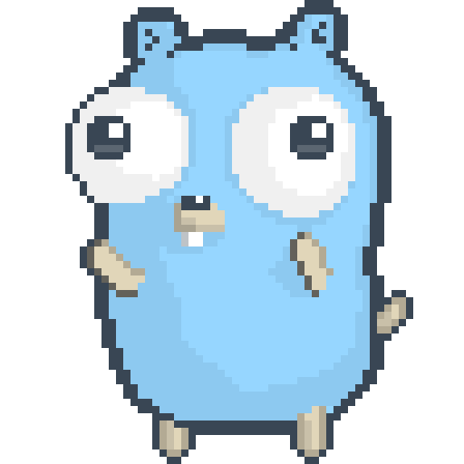
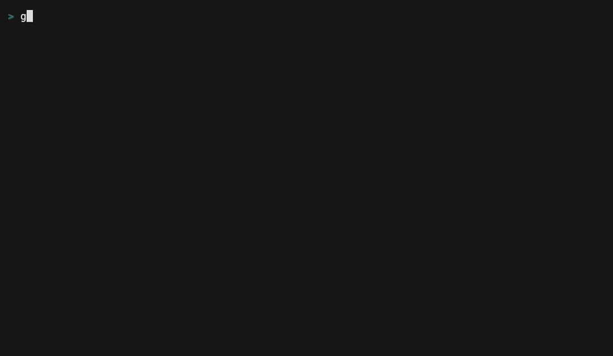

# golings

[](https://github.com/cleonte/golings/actions/workflows/test.yml)

<p align="center"></p>

> rustlings but for golang this time

You may know [rustlings](https://github.com/rust-lang/rustlings), right? If you don't, please go ahead and check out.
`rustlings` is awesome. It is a CLI app designed to teach the awesome Rust programming language through exercises.

`golings` has the very same idea, but for the [Go programming language](https://go.dev/)

> **About this project:** golings started as a fork of [mauricioabreu/golings](https://github.com/mauricioabreu/golings) and is now maintained independently. The idea and the first exercises are by Mauricio Abreu and the upstream contributors, and the project is released under the Apache-2.0 license, which this project keeps (see [LICENSE](LICENSE) and [NOTICE](NOTICE)). Upstream has not had a commit since March 2025, so this project is maintained on its own. What it adds:
>
> * Current Go (1.26 and newer) and current dependencies, CI on Go 1.26, 1.27 and the latest stable release, and release binaries for Linux, macOS and Windows.
> * 206 exercises in 41 topics, where upstream has 43 in 13 (strings, pointers, methods, interfaces, errors, types, closures, defer, packages, testing, context, time, io, files, http, regexp, template, encoding, rand, iterators, sorting, slog, concurrency, pitfalls, Go 1.27 and more), each with a hint, a `// TODO:` at the spot to fix and a verified solution.
> * A full-screen `watch` (hint, solution, reset, next, list, check all), and the commands `init`, `reset`, `solution` and `doctor`.
> * Exercises that need a newer Go, or the race detector, are skipped with a message instead of failing, and the output of failures is shortened to the lines that matter.

**Supported Go versions:** Go 1.26 or newer (CI tests 1.26, 1.27 and the latest stable release). The exercises of the `go127` topic, and `concurrent13`, are about Go 1.27: with an older Go they are skipped, with a message, and the rest of the course runs as usual.

After setting up all the tools required to run `golings` you have the task to fix tiny go programs.

## Installing

First, you need to have `go` installed. You can install it by visiting the [Go downloads page](https://go.dev/dl/)

There are several ways to install `golings`

### Option 1: GO install

```sh
go install github.com/cleonte/golings/golings@latest
```

Or build from a checkout of this repository:

```sh
git clone https://github.com/cleonte/golings.git
cd golings
go install ./golings
```

Add `go/bin` to your PATH if you want to run golings anywhere in your terminal. From the official docs:

> The install directory is controlled by the GOPATH and GOBIN environment variables. If GOBIN is set, binaries are installed to that directory. If GOPATH is set, binaries are installed to the bin subdirectory of the first directory in the GOPATH list. Otherwise, binaries are installed to the bin subdirectory of the default GOPATH ($HOME/go or %USERPROFILE%\go).

#### Windows installation

Two concurrency exercises (`concurrent2` and `concurrent10`) need the race detector, which needs `CGO` and a C compiler on Windows and Linux (on macOS it needs nothing). Without them those exercises are skipped, with a message, and everything else runs as usual; `golings doctor` tells you which ones. To run them too:

1. Install scoop package manager [Scoop Homepage](https://scoop.sh)
    ```powershell
    Set-ExecutionPolicy -ExecutionPolicy RemoteSigned -Scope CurrentUser
    Invoke-RestMethod -Uri https://get.scoop.sh | Invoke-Expression
    ```
1. Install MINGW using scoop
    ```powershell
    scoop install mingw
    ```
1. Close the Powershell session


### Option 2: Binaries

Go to the [releases page](https://github.com/cleonte/golings/releases) and choose the option that best fits your environment.

### Option 3: Web version (playground)

[@Grubba27](https://github.com/Grubba27/) worked hard to create a web version: https://golings.vercel.app/

It's pretty awesome and uses the playground so you can play with the exercises without installing anything.

### Option 4: DevContainer

1. Install Docker/Podman & VSCode & Configure
1. Clone the repository and open it in VSCode.
1. You will be prompted to reopen the code in a devcontainer. The container is pre-configured with go and all of the tools needed to debug go code.
1. Open a new embeded terminal and run `golings watch` to start the exercises.

## Doing exercises

All the exercises can be found in the directory `exercises/<topic>`. For every topic there is an additional README file with some resources to get you started on the topic. We really recommend that you have a look at them before you start.

Now you have the task to fix all the programs. Some of them don't compile, and you need to fix them. Some of them compile, but have tests and you need to write some code to have them all green (these are the `compile` and `test` modes).

If you installed golings with `go install` or from a binary, create a folder with all the exercises:

```sh
golings init
cd golings-exercises
```

`golings init` takes an optional folder name. If you cloned the repository instead, run the commands below from the root of the clone.

To run the exercises in the recommended order while taking advantage of fast feedback loop, use the _watch_ command:

```sh
golings watch
```

For Windows, only if you installed the C compiler above:
```powershell
$env:CGO_ENABLED=1
golings watch
```

This opens a full-screen view: your progress at the top and the result of the current exercise below. Every time you save a file it runs the exercise again. Keys: `h` hint (some exercises have smaller hints first: press `h` again for the next one), `s` solution (asks first, it spoils the exercise), `r` reset the exercise (asks first), `n` move on to the next exercise once this one works (it takes out the `// I AM NOT DONE` marker for you), `c` check all the exercises (runs every one of them and lists which work, without changing any file), `l` list every exercise to open any of them (type `/` to filter by name or topic; `n` then goes back to the first pending one), `f` show all of the output of a failure that was shortened (a data race report or a panic is cut down to the lines in your exercise; the note under the failure says when that happened), `↑`/`↓` scroll, `esc` go back, `q` quit.

If you prefer plain line-by-line output, or when input or output is not a terminal (for example when piping), use `golings watch --plain`. There you can type `hint` (again, for more help) or `list` and press Enter, and `exit` to quit.



To run the next pending exercise:

```sh
golings run next
```

If you want to run a single exercise:

```sh
golings run variables1
```

A data race report or a panic is cut down to the accesses and the lines in your exercise, without addresses and the frames of the runtime. If you want to see all of it, add `--verbose` (it works with `run`, `verify` and `watch --plain`; in the full-screen view press `f`):

```sh
golings run concurrent2 --verbose
```

In case you are stuck and need a hint:

```sh
golings hint variables1
```

Some exercises have smaller hints too, from a nudge that says what the failure means to one that says where to change. `golings hint variables1 --level 1` shows the smallest, and the full hint is what you get without the flag.

If you want to start an exercise over, restore it to its original state (this discards your changes, so it asks first):

```sh
golings reset variables1
```

Once an exercise is done you can compare your answer with the solution. While it is still pending the solution stays hidden, unless you ask for it:

```sh
golings solution variables1
golings solution variables1 --reveal
```

To list all exercises and your progress per topic:

```sh
golings list
```

To compile and run all the exercises:

```sh
golings verify
```

If something does not work, check your setup (Go version, exercise files, what the race detector needs):

```sh
golings doctor
```

If you need help with CLI commands:

```sh
golings --help
```

A demo running the command `golings run <exercise name>`


## Contributing

See [CONTRIBUTING.md](./CONTRIBUTING.md)

Found a problem with an exercise? Open an issue with the Exercise problem template.

## Learning resources

* [Golang official tutorial](https://go.dev/doc/tutorial/)
* [Go by example](https://gobyexample.com)
* [Aprenda Go](https://www.youtube.com/playlist?list=PLCKpcjBB_VlBsxJ9IseNxFllf-UFEXOdg)

## Other 'lings

* [rustlings](https://github.com/rust-lang/rustlings)
* [ziglings](https://github.com/ratfactor/ziglings)

## Credits

golings was created by [Mauricio Abreu](https://github.com/mauricioabreu/golings), and this project builds on that work.

The dancing gopher is pixel art by [Egon Elbre](https://github.com/egonelbre/gophers) (CC0), exported from his `dance.ase` at 8x, based on the Go gopher designed by [Renée French](https://reneefrench.blogspot.com/) (CC BY 4.0).
